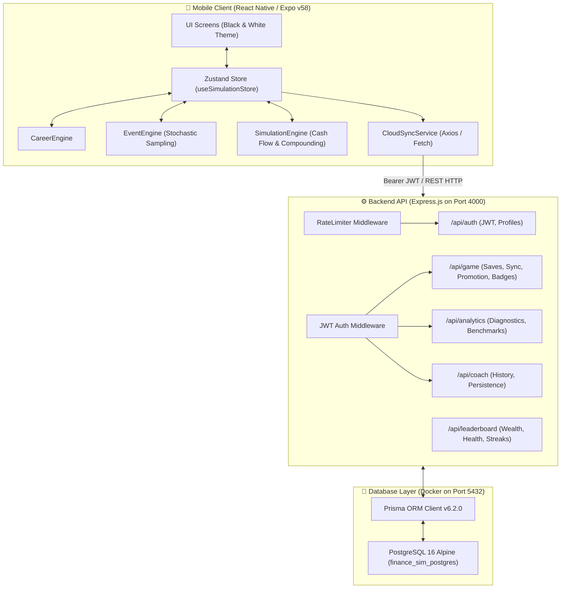

# Finance Life Simulator — Complete Technical Architecture & System Guide

A comprehensive, production-grade manual documenting the entire **Finance Life Simulator** platform: Frontend (React Native/Expo), Backend (Express/Node.js), Database (PostgreSQL/Prisma ORM), Simulation Mathematics, 100+ Stochastic Life Scenarios, Career & Promotion Mechanics, and all 22 REST API endpoints.

---

## Table of Contents
1. [System Architecture & Data Flow](#1-system-architecture--data-flow)
2. [Frontend Mobile Architecture (React Native & Expo)](#2-frontend-mobile-architecture-react-native--expo)
   - [State Machine & Store (Zustand)](#state-machine--store-zustand)
   - [UI Design System & Black/White Theme](#ui-design-system--blackwhite-theme)
   - [Key Screens & User Journeys](#key-screens--user-journeys)
3. [Core Simulation & Game Engines](#3-core-simulation--game-engines)
   - [Career & Promotion Engine](#career--promotion-engine)
   - [Stochastic Event Engine (True Weighted Random Sampling)](#stochastic-event-engine-true-weighted-random-sampling)
   - [100+ Life Scenarios Breakdown](#100-life-scenarios-breakdown)
   - [Financial Mathematics, Compounding & Health Scoring](#financial-mathematics-compounding--health-scoring)
4. [Backend API Architecture (Express & Node.js)](#4-backend-api-architecture-express--nodejs)
   - [Middleware & Sliding Window Rate Limiting](#middleware--sliding-window-rate-limiting)
   - [JWT Authentication & Token Rotation](#jwt-authentication--token-rotation)
5. [Database Architecture & Data Modeling (PostgreSQL & Prisma)](#5-database-architecture--data-modeling-postgresql--prisma)
   - [Database Schema & Models](#database-schema--models)
   - [Indexing Strategy for High-Speed Leaderboards](#indexing-strategy-for-high-speed-leaderboards)
   - [Database Seeding](#database-seeding)
6. [Complete REST API Specification (22 Endpoints)](#6-complete-rest-api-specification-22-endpoints)
7. [Step-by-Step Execution & Deployment Runbook](#7-step-by-step-execution--deployment-runbook)
8. [Troubleshooting & Verification Matrix](#8-troubleshooting--verification-matrix)

---

## 1. System Architecture & Data Flow



### Complete End-to-End Simulation Loop
1. **Player Initialization**: User registers/logs in via `/api/auth`, selects a character archetype (or ₹0 Start Canvas), initializing local Zustand state.
2. **Monthly Advance**:
   - `SimulationEngine.ts` calculates monthly salary, deducts needs & wants, deposits SIP investments, and computes market yield + debt interest.
   - `CareerEngine.ts` evaluates tenure and performance score for promotion jumps.
   - `EventEngine.ts` stochastically samples a life scenario based on current cash, debt, and season.
3. **Player Decision**: Player chooses a path; financial deltas immediately compound into balance sheet.
4. **Cloud Synchronization**: State automatically batches to `POST /api/game/sync`, updating indexed Net Worth, Health Score, and audit logs.
5. **Community Benchmarking**: Player queries `/api/analytics/peer-benchmark/:id` and `/api/leaderboard/*` to see real-time standing against global peers.

---

## 2. Frontend Mobile Architecture (React Native & Expo)

### State Machine & Store (`Zustand`)
The mobile frontend state is managed centrally in [`src/store/useSimulationStore.ts`](file:///d:/CSLAB/src/store/useSimulationStore.ts).

```ts
interface SimulationState {
  // Authentication & Identity
  token: string | null;
  activeSaveId: string | null;
  character: CharacterProfile;
  
  // Timeline Tracking
  currentAge: number;
  currentMonth: number;
  totalMonthsSimulated: number;
  currentStage: LifeStage;

  // Financial Ledger
  balanceSheet: BalanceSheet;
  budget: Budget;
  healthScore: FinancialHealthScore;
  
  // Career Track
  careerLadderLevel: number;        // Level 1 to 4
  monthsInCurrentRole: number;
  activePromotionOffer: PromotionOffer | null;

  // Stochastic Scenarios
  activeEvent: SimulationEvent | null;
  eventHistory: DecisionRecord[];
  
  // Gamification & Badges
  gamification: GamificationState;

  // Actions
  initializeCustomCharacter: (config: CustomCharacterConfig) => void;
  advanceMonth: () => Promise<void>;
  makeDecision: (optionId: string) => void;
  acceptPromotion: (lifestyleChoice: LifestyleInflationChoice) => Promise<void>;
  dismissPromotion: () => void;
  syncWithCloud: () => Promise<void>;
}
```

#### Key Store Guarantees
- **No Hardcoded Starts**: Calling `initializeCustomCharacter()` allows starting with ₹0 Net Worth, ₹0 Debt, and custom entry-level salaries.
- **Deep Immutability**: All balance sheet calculations create immutable clones of asset and liability arrays to prevent stale re-renders.
- **Offline Resilient**: Local simulation can run fully offline; state syncs whenever network connection resumes.

---

### UI Design System & Black/White Theme
Per strict user requirements, all colorful AI templates and neon glow effects were replaced with a **high-contrast, minimalist Monochrome (Black & White)** aesthetic:

| Design Token | Hex Value | Purpose |
| :--- | :--- | :--- |
| `--bg-canvas` | `#000000` | Pure pitch-black canvas background |
| `--bg-card` | `#121212` | Elevated dark charcoal card containers |
| `--bg-card-subtle` | `#1A1A1A` | Secondary nested option cards |
| `--border-subtle` | `#262626` | 1px fine razor border |
| `--border-focus` | `#FFFFFF` | Active selection or highlighted card border |
| `--text-primary` | `#FFFFFF` | Bold headings, key metrics, hero net worth |
| `--text-secondary` | `#A0A0A0` | Microcopy, labels, scenario narrative text |
| `--text-tertiary` | `#666666` | Timestamps, micro badges, breadcrumbs |
| `--btn-primary-bg` | `#FFFFFF` | Solid high-contrast call-to-action button |
| `--btn-primary-txt` | `#000000` | Stark black bold typography on white buttons |

---

### Key Screens & User Journeys

#### 1. Onboarding Screen ([`src/ui/screens/OnboardingScreen.tsx`](file:///d:/CSLAB/src/ui/screens/OnboardingScreen.tsx))
- **3 Dynamic Setup Modes**:
  1. **Play Archetype**: Choose from 6 pre-built characters (`Kabir`, `Aarav`, `Priya`, `Meera`, `Vikram`, `Ananya`).
  2. **Start from ₹0 (Ground Zero Profile Builder)**:
     - Allows player to define their own real-world or aspirational identity:
       - **Name & Age**: Personalized character identity.
       - **Job Title & Profession**: Choose from 8 quick role presets (Junior SDE, Freelance Designer, Financial Analyst, Digital Marketer, Solo Founder, Intern, Job Seeker) or type any custom profession.
       - **Income Source Category**: Full-Time Salary, Freelance / Gigs, Side Business, Internship Stipend, or Job Hunting (₹0).
       - **Monthly Earnings & Living Expenses**: Configure baseline income and expenses with automatic monthly savings surplus calculation.
       - **Ground Zero Net Worth Guarantee**: Cash = ₹0, Savings = ₹0, Debt = ₹0, Net Worth = ₹0.
  3. **Custom Setup**: Full sandbox mode allowing custom starting liquid cash and initial debt balances.
- **Stat Cards**: Displays starting cash, salary, education debt, career track, and unique perks.

#### 2. Simulation Dashboard ([`src/ui/screens/DashboardScreen.tsx`](file:///d:/CSLAB/src/ui/screens/DashboardScreen.tsx))
- **Net Worth Hero Banner**: Shows accumulated Net Worth in Indian Rupee format (`₹2,85,000`) with Month-over-Month percentage.
- **Financial Health Score Gauge**: Circular meter displaying 0–100 score and letter grade (`Grade A • Strong Financial Fortress`).
- **4-Tier Cash Flow Breakdown**: Visualizes Monthly Income vs 50% Needs, 20% Wants, 30% Investments.
- **Action Controls**: Advance Month, Portfolio Review, AI Financial Coach trigger.

#### 3. Career Promotion Modal ([`src/ui/components/PromotionModal.tsx`](file:///d:/CSLAB/src/ui/components/PromotionModal.tsx))
- Triggered whenever `CareerEngine.ts` qualifies the player for a title upgrade.
- Shows previous title ➔ new title, old salary ➔ new salary (+22% to +38%), and performance bonus credit.
- Forces player to resolve the **Lifestyle Inflation Dilemma**:
  - **The Compounding Machine**: Auto-invest 80% of raise, 20% to lifestyle.
  - **Balanced Growth**: 50% invest, 50% lifestyle.
  - **Upgrade Everything**: 100% lifestyle upgrade, freezing wealth acceleration.

#### 4. Stochastic Life Event Screen
- Presents random real-world dilemmas with 3 distinct financial trade-offs (Cash out, Long-term EV, Sweat equity).

#### 5. Leaderboards & Analytics Screen
- Global rankings across Wealth, Health Score, and Longevity.
- Displays player's percentile rank against the community (`Top 31%`).

---

## 3. Core Simulation & Game Engines

### Career & Promotion Engine ([`src/core/career/CareerEngine.ts`](file:///d:/CSLAB/src/core/career/CareerEngine.ts))

The simulation features 4 comprehensive career ladders with 4 distinct seniority tiers:

```
Tech Track:
Tier 1: Associate Software Engineer      (₹45k - ₹60k/mo)
Tier 2: SDE-2 (Lead Developer)           (₹75k - ₹1.1L/mo)   [+36% to +45% hike]
Tier 3: Senior Staff SDE / Tech Lead     (₹1.4L - ₹2.2L/mo)  [+30% to +40% hike]
Tier 4: Principal Architect / VP Eng     (₹2.8L - ₹4.5L/mo)  [+25% to +35% hike]

Business & Finance Track:
Tier 1: Financial Analyst                (₹40k - ₹55k/mo)
Tier 2: Senior Associate / Portfolio Mgr (₹70k - ₹1.0L/mo)
Tier 3: VP of Investment Banking        (₹1.5L - ₹2.5L/mo)
Tier 4: Managing Director / Partner      (₹3.5L - ₹6.0L/mo)

Creative & Freelance Track:
Tier 1: Junior Designer / Copywriter     (₹30k - ₹45k/mo)
Tier 2: Senior Art Director / Specialist (₹60k - ₹90k/mo)
Tier 3: Studio Lead / Retainer Agency    (₹1.2L - ₹1.8L/mo)
Tier 4: Executive Creative Director      (₹2.5L - ₹4.0L/mo)

Corporate Generalist Track:
Tier 1: Operations Associate             (₹35k - ₹50k/mo)
Tier 2: Operations Manager               (₹65k - ₹95k/mo)
Tier 3: Director of Strategy             (₹1.3L - ₹2.0L/mo)
Tier 4: Chief Operating Officer (COO)    (₹2.5L - ₹4.5L/mo)
```

#### Promotion Evaluation Formula
Promotion eligibility is checked every month:
$$\text{Tenure Score} = \min\left(1.0, \frac{\text{monthsInCurrentRole}}{\text{roleDurationRequired}}\right)$$
$$\text{Performance Metric} = (\text{savingsRateScore} \times 0.4) + (\text{healthScore} \times 0.6)$$
$$\text{Promotion Probability} = \text{Tenure Score} \times \text{Performance Metric} \times \text{CharacterPerkMultiplier}$$

If probability exceeds threshold (or tenure hits maximum ceiling of 24 months), a promotion offer is triggered.

---

### Stochastic Event Engine (True Weighted Random Sampling)
[`src/core/events/EventEngine.ts`](file:///d:/CSLAB/src/core/events/EventEngine.ts) was completely rewritten to eliminate deterministic sequential order (`unplayed[0]`). Events are selected via **Dynamic Weighted Random Sampling**:

```ts
export function sampleRandomEvent(
  allEvents: SimulationEvent[],
  playedEventIds: Set<string>,
  context: SimulationContext
): SimulationEvent | null {
  const unplayed = allEvents.filter((e) => !playedEventIds.has(e.id));
  if (unplayed.length === 0) return null;

  // Calculate dynamic weight for each scenario based on player financial posture
  const weighted = unplayed.map((event) => {
    let weight = 100;

    // Financial Stress Weighting: Low cash increases emergency dilemmas
    if (event.category === 'emergency' && context.liquidCash < 50000) weight += 80;
    
    // High Portfolio Weighting: High net worth increases market & tax dilemmas
    if (event.category === 'markets' && context.netWorth > 1000000) weight += 70;
    
    // Seasonal Triggers
    if (event.category === 'taxes' && context.currentMonth === 3) weight += 150; // Indian FY End (March)
    if (event.category === 'lifestyle' && (context.currentMonth === 10 || context.currentMonth === 11)) weight += 90; // Diwali season

    return { event, weight };
  });

  const totalWeight = weighted.reduce((acc, item) => acc + item.weight, 0);
  let randomVal = Math.random() * totalWeight;

  for (const item of weighted) {
    if (randomVal < item.weight) return item.event;
    randomVal -= item.weight;
  }

  return weighted[0].event;
}
```

---

### 100+ Life Scenarios Breakdown
[`src/core/events/scenarios.ts`](file:///d:/CSLAB/src/core/events/scenarios.ts) contains **100+ realistic, culturally nuanced financial dilemmas** categorized across 8 life domains:

| Category | Count | Scenario Archetypes & Topics |
| :--- | :---: | :--- |
| **Career & Promotions** | 18 | Moonlight startup offers, overseas relocation, client retention bonus, equity vs salary trade-offs. |
| **Housing & Real Estate**| 14 | Buying 3BHK on home loan vs renting, builder delays, security deposit disputes, home solar upgrade. |
| **Lifestyle & Creep** | 16 | Luxury SUV on 7-year EMI, destination weddings, international trips, gourmet dining subscriptions. |
| **Medical & Emergencies**| 14 | Family medical surge without insurance, parent critical illness, emergency root canal, laptop theft. |
| **Scams & Financial Traps**| 12 | Telegram crypto pumps, instant loan app extortion, MLM scheme invitations, unregistered chit funds. |
| **Markets & Compounding**| 14 | 20% Nifty crash panic-selling vs buying dip, small-cap frenzy, debt fund default, IPO allotment. |
| **Taxes & Compliance** | 8 | Old vs New Tax Regime, Section 80C rush, capital gains tax filing, audit notices. |
| **Family & Social Pressures**| 12 | In-law gold purchase, lending money to unreliable relatives, sponsoring sibling higher education. |

---

### Financial Mathematics, Compounding & Health Scoring

#### 1. Balance Sheet Compounding
Every simulated month:
- **Liquid Cash**: $\text{Cash}_{t+1} = \text{Cash}_t + \text{Monthly Income} - \text{Needs} - \text{Wants} - \text{SIP Investment}$
- **Equity Portfolio**: $\text{Portfolio}_{t+1} = (\text{Portfolio}_t + \text{Monthly SIP}) \times \left(1 + \frac{r_{\text{equity}}}{12}\right)$ (annual baseline $r_{\text{equity}} = 12\%$)
- **Debt Amortization**: $\text{Principal}_{t+1} = \text{Principal}_t \times \left(1 + \frac{r_{\text{debt}}}{12}\right) - \text{EMI}$
- **Net Worth**: $\text{Net Worth} = \sum \text{Assets} - \sum \text{Liabilities}$

#### 2. Financial Health Score Formula (0 to 100)
The score evaluates 4 key pillars:
$$\text{Health Score} = S_{\text{emergency}} (30\text{ pts}) + S_{\text{dti}} (25\text{ pts}) + S_{\text{savings}} (25\text{ pts}) + S_{\text{networth}} (20\text{ pts})$$

* **Emergency Buffer Score (30 pts)**:
  $$\text{Months} = \frac{\text{Liquid Cash}}{\text{Monthly Needs + Wants}}$$
  Full 30 pts awarded if $\text{Months} \ge 6.0$; scaled linearly between 0 and 6 months.
* **Debt-to-Income Score (25 pts)**:
  $$\text{DTI} = \frac{\text{Total Monthly EMI}}{\text{Monthly Income}}$$
  Full 25 pts if $\text{DTI} = 0$; 0 pts if $\text{DTI} \ge 0.50$ (50%).
* **Savings Rate Score (25 pts)**:
  $$\text{Savings Rate} = \frac{\text{Monthly Savings + SIP}}{\text{Monthly Income}}$$
  Full 25 pts if $\text{Savings Rate} \ge 40\%$; scaled linearly below.
* **Positive Net Worth Score (20 pts)**:
  Awarded based on asset-to-liability safety margin.

---

## 4. Backend API Architecture (Express & Node.js)

The backend server is implemented in TypeScript with Express 4, Prisma ORM, and PostgreSQL.

### Architecture Highlights
- **Location**: `d:\CSLAB\server`
- **Main Server File**: [`server/src/index.ts`](file:///d:/CSLAB/server/src/index.ts)
- **Port**: `4000` (configurable via `process.env.PORT`)
- **JSON Body Parser Limit**: `10mb` (to handle full ledger exports and state backups)
- **Graceful Shutdown**: Intercepts `SIGINT` to safely disconnect Prisma connection pools.

### Middleware

#### 1. JWT Authentication Middleware ([`server/src/middleware/auth.ts`](file:///d:/CSLAB/server/src/middleware/auth.ts))
Extracts `Authorization: Bearer <token>` from HTTP request headers. Verifies token against `JWT_SECRET`. Enriches request with:
```ts
export interface AuthenticatedRequest extends Request {
  user?: {
    userId: string;
    email: string;
  };
}
```

#### 2. Sliding Window Rate Limiter ([`server/src/middleware/rateLimit.ts`](file:///d:/CSLAB/server/src/middleware/rateLimit.ts))
In-memory sliding window rate limiter that tracks IP timestamps with automatic background garbage collection every 5 minutes.
- Applied to `/api/auth/*` routes (50 requests per 15-minute window per IP).
- Returns HTTP `429 Too Many Requests` with a standard `Retry-After: <seconds>` header.

---

## 5. Database Architecture & Data Modeling (PostgreSQL & Prisma)

The database runs in a containerized PostgreSQL 16 Alpine instance managed by Docker (`finance_sim_postgres`).

### Database Schema ([`server/prisma/schema.prisma`](file:///d:/CSLAB/server/prisma/schema.prisma))

```prisma
datasource db {
  provider = "postgresql"
  url      = env("DATABASE_URL")
}

generator client {
  provider = "prisma-client-js"
}

model User {
  id           String         @id @default(uuid())
  email        String         @unique
  passwordHash String
  displayName  String
  createdAt    DateTime       @default(now())
  updatedAt    DateTime       @updatedAt
  gameSaves    GameSave[]
  refreshTokens RefreshToken[]
}

model RefreshToken {
  id        String   @id @default(uuid())
  token     String   @unique
  userId    String
  user      User     @relation(fields: [userId], references: [id], onDelete: Cascade)
  expiresAt DateTime
  createdAt DateTime @default(now())
}

model GameSave {
  id                   String         @id @default(uuid())
  userId               String
  user                 User           @relation(fields: [userId], references: [id], onDelete: Cascade)
  characterName        String         @default("Player")
  characterArchetype   String         @default("custom")
  currentAge           Int            @default(22)
  currentMonth         Int            @default(1)
  currentStage         String         @default("first_job")
  totalMonthsSimulated Int            @default(0)
  
  // Indexed metrics for high-speed community leaderboards
  netWorth             Float          @default(0)
  healthScoreValue     Float          @default(50)
  level                Int            @default(1)
  isActive             Boolean        @default(true)
  
  // JSONB Ledger Payloads
  balanceSheet         Json
  budget               Json
  healthScore          Json
  gamification         Json
  
  decisionLogs         DecisionLog[]
  promotionLogs        PromotionLog[]
  coachChatLogs        CoachChatLog[]
  
  createdAt            DateTime       @default(now())
  updatedAt            DateTime       @updatedAt

  @@index([userId])
  @@index([netWorth])
  @@index([healthScoreValue])
  @@index([totalMonthsSimulated])
  @@index([isActive])
}

model DecisionLog {
  id             String   @id @default(uuid())
  gameSaveId     String
  gameSave       GameSave @relation(fields: [gameSaveId], references: [id], onDelete: Cascade)
  eventId        String
  eventTitle     String
  selectedOption String
  consequence    Json
  monthSimulated Int
  createdAt      DateTime @default(now())

  @@index([gameSaveId])
}

model PromotionLog {
  id              String   @id @default(uuid())
  gameSaveId      String
  gameSave        GameSave @relation(fields: [gameSaveId], references: [id], onDelete: Cascade)
  previousTitle   String
  newTitle        String
  previousSalary  Float
  newSalary       Float
  hikePercentage  Float
  bonusAmount     Float    @default(0)
  lifestyleChoice String
  monthSimulated  Int
  createdAt       DateTime @default(now())

  @@index([gameSaveId])
}

model CoachChatLog {
  id             String   @id @default(uuid())
  gameSaveId     String
  gameSave       GameSave @relation(fields: [gameSaveId], references: [id], onDelete: Cascade)
  userQuery      String
  coachResponse  String
  monthSimulated Int
  createdAt      DateTime @default(now())

  @@index([gameSaveId])
}
```

### Indexing Strategy for High-Speed Leaderboards
The `GameSave` model includes B-Tree indexes on `netWorth`, `healthScoreValue`, and `totalMonthsSimulated`. This allows `ORDER BY netWorth DESC LIMIT 25` to execute in sub-millisecond time without table scans, even with thousands of active saves.

### Database Seeding (`server/prisma/seed.ts`)
Populates initial community benchmark players:
1. **Kabir Mehta** (`Senior SDE`, Net Worth ₹18,50,000, Health Score 92, 38 mos)
2. **Priya Deshmukh** (`Conservative Saver`, Net Worth ₹12,20,000, Health Score 96, 24 mos)
3. **Vikram Reddy** (`Startup Founder`, Net Worth ₹42,00,000, Health Score 84, 48 mos)

---

## 6. Complete REST API Specification (22 Endpoints)

All endpoints accept and return `application/json`. Authenticated routes require header:  
`Authorization: Bearer <accessToken>`

### System & Discovery
#### 1. `GET /`
- **Description**: Root API discovery document listing all endpoints and versions.
- **Auth**: None.
- **Response**: `200 OK` (JSON overview).

#### 2. `GET /api/health`
- **Description**: Verifies service state and executes `SELECT 1` on PostgreSQL.
- **Auth**: None.
- **Response**:
  ```json
  {
    "status": "healthy",
    "service": "finance-life-sim-backend",
    "database": "connected",
    "timestamp": "2026-10-21T01:00:00.000Z"
  }
  ```

---

### Authentication (`/api/auth`)

#### 3. `POST /api/auth/register`
- **Body**: `{ "displayName": "Aarav Sharma", "email": "aarav@example.com", "password": "password123" }`
- **Response**: `201 Created`
  ```json
  {
    "message": "Account registered successfully",
    "accessToken": "eyJhbGciOi...",
    "refreshToken": "7a8b9c...",
    "user": { "id": "uuid", "email": "aarav@example.com", "displayName": "Aarav Sharma" }
  }
  ```

#### 4. `POST /api/auth/login`
- **Body**: `{ "email": "aarav@example.com", "password": "password123" }`
- **Response**: `200 OK` (Tokens & User profile).

#### 5. `POST /api/auth/refresh`
- **Body**: `{ "refreshToken": "7a8b9c..." }`
- **Response**: `200 OK` (`{ "accessToken": "eyJhbGciOi..." }`).

#### 6. `GET /api/auth/me`
- **Auth**: Required.
- **Response**: `200 OK` (User details and active save count).

#### 7. `PUT /api/auth/profile`
- **Auth**: Required.
- **Body**: `{ "displayName": "Aarav (Lead SDE)" }`
- **Response**: `200 OK` (Updated user profile).

#### 8. `PUT /api/auth/password`
- **Auth**: Required.
- **Body**: `{ "currentPassword": "password123", "newPassword": "newStrongPassword456" }`
- **Response**: `200 OK` (`{ "message": "Password changed successfully." }`).

#### 9. `DELETE /api/auth/account`
- **Auth**: Required.
- **Response**: `200 OK` (Cascades and deletes user, saves, logs, and tokens).

---

### Game Simulation & Career Sync (`/api/game`)

#### 10. `POST /api/game/sync`
- **Auth**: Required.
- **Description**: Upserts simulation state snapshot and indexes metrics.
- **Body**:
  ```json
  {
    "gameSaveId": "optional-uuid",
    "characterName": "Aarav",
    "characterArchetype": "char_techie",
    "currentAge": 24,
    "currentMonth": 8,
    "currentStage": "first_job",
    "totalMonthsSimulated": 14,
    "balanceSheet": { "netWorth": 285000, "cash": 120000, "assets": [], "liabilities": [] },
    "budget": { "monthlyIncome": 75000, "needs": 30000, "wants": 15000, "savings": 30000 },
    "healthScore": { "totalScore": 88, "emergencyFundMonths": 4.4, "savingsRate": 40 },
    "gamification": { "level": 4, "experiencePoints": 650, "unlockedBadges": ["sip_master"] },
    "decisionLog": {
      "eventId": "event_angel_cafe",
      "eventTitle": "AI Cafe Angel Check",
      "selectedOption": "Invest ₹60,000 Angel Check",
      "consequence": { "cashDelta": -60000 },
      "monthSimulated": 14
    }
  }
  ```
- **Response**: `200 OK` (`{ "success": true, "gameSaveId": "uuid", "message": "State synced." }`).

#### 11. `POST /api/game/promotion`
- **Auth**: Required.
- **Description**: Logs promotion event and lifestyle inflation dilemma choice into permanent ledger.
- **Body**:
  ```json
  {
    "gameSaveId": "uuid",
    "previousTitle": "Junior SDE",
    "newTitle": "SDE-2 (Lead Developer)",
    "previousSalary": 55000,
    "newSalary": 75000,
    "hikePercentage": 36,
    "bonusAmount": 55000,
    "lifestyleChoice": "The Compounding Machine (80% Invested)",
    "monthSimulated": 14
  }
  ```
- **Response**: `201 Created` (`{ "success": true, "promotionLog": { ... } }`).

#### 12. `GET /api/game/saves`
- **Auth**: Required.
- **Description**: Lists all active character slots for the user with net worth and counts.
- **Response**: `200 OK` (`{ "saves": [ ... ] }`).

#### 13. `GET /api/game/state/:id?`
- **Auth**: Required.
- **Description**: Retrieves specific save slot by ID or returns the latest active save with recent decision and promotion logs.
- **Response**: `200 OK` (`{ "found": true, "save": { ... } }`).

#### 14. `GET /api/game/achievements`
- **Auth**: None / Optional.
- **Description**: Returns full master catalog of all in-game badges with XP rewards.
- **Response**: `200 OK` (`{ "totalAchievements": 8, "achievements": [ ... ] }`).

#### 15. `POST /api/game/achievement/unlock`
- **Auth**: Required.
- **Body**: `{ "gameSaveId": "uuid", "badgeId": "sip_master" }`
- **Response**: `200 OK` (`{ "success": true, "newLevel": 4, "totalXp": 800 }`).

#### 16. `GET /api/game/market-pulse`
- **Auth**: None / Optional.
- **Description**: Macroeconomic climate indicators (inflation 5.2%, repo rate 6.5%, market sentiment).
- **Response**: `200 OK`.

#### 17. `GET /api/game/export/:id`
- **Auth**: Required.
- **Description**: Downloads full JSON ledger containing balance sheet history, decision logs, and promotion logs.
- **Response**: `200 OK` (`Content-Disposition: attachment; filename="sim_save_Aarav.json"`).

#### 18. `DELETE /api/game/save/:id`
- **Auth**: Required.
- **Description**: Deletes a specific character save slot.
- **Response**: `200 OK` (`{ "message": "Save slot deleted successfully." }`).

---

### Analytics & Diagnostics (`/api/analytics`)

#### 19. `GET /api/analytics/:gameSaveId`
- **Auth**: Required.
- **Description**: Computes financial audit grade (`A+`, `A`, `B`, `C`, `D`), emergency buffer months, savings rate, career bonus summary, and actionable smart insights.
- **Response**: `200 OK`.

#### 20. `GET /api/analytics/peer-benchmark/:gameSaveId`
- **Auth**: Required.
- **Description**: Calculates player's exact community percentile rank vs database averages.
- **Response**:
  ```json
  {
    "player": { "characterName": "Aarav", "netWorth": 285000, "percentile": 69 },
    "communityAverages": { "totalSimulationsTracked": 5, "averageNetWorth": 581154 }
  }
  ```

---

### Leaderboards (`/api/leaderboard`)

#### 21. `GET /api/leaderboard/wealth`
- **Auth**: None.
- **Description**: Top 25 active players ranked by Net Worth.

#### 22. `GET /api/leaderboard/health`
- **Auth**: None.
- **Description**: Top 25 active players ranked by Financial Health Score.

#### 23. `GET /api/leaderboard/streaks`
- **Auth**: None.
- **Description**: Top 25 active players ranked by simulation longevity (months survived).

---

### AI Financial Coach (`/api/coach`)

#### 24. `POST /api/coach/message`
- **Auth**: Required.
- **Body**:
  ```json
  {
    "gameSaveId": "uuid",
    "userQuery": "How should I allocate my ₹55,000 bonus?",
    "coachResponse": "Invest ₹35,000 into Nifty 50 and add ₹20,000 to emergency fund.",
    "monthSimulated": 14
  }
  ```
- **Response**: `201 Created` (`{ "success": true, "id": "uuid" }`).

#### 25. `GET /api/coach/history/:gameSaveId`
- **Auth**: Required.
- **Description**: Retrieves past Q&A conversation logs.
- **Response**: `200 OK` (`{ "history": [ ... ] }`).

---

## 7. Step-by-Step Execution & Deployment Runbook

### Prerequisites
1. **Node.js**: v20+ or v22+
2. **Docker Desktop**: Running locally
3. **Expo Go app**: Installed on Android / iOS test device (or Android Emulator)

### Step 1: Ensure Docker Database is Running
From workspace root (`d:\CSLAB`):
```powershell
docker ps
```
If `finance_sim_postgres` is stopped, start it:
```powershell
docker start finance_sim_postgres
```
*(Port 5432 is exposed to localhost; user: `postgres`, password: `postgrespassword`, db: `finance_sim_db`)*

### Step 2: Database Setup & Migrations
```powershell
cd d:\CSLAB\server
npx prisma generate
npx prisma migrate dev
npx tsx prisma/seed.ts
```

### Step 3: Run Full Backend Test Suite
Verify all 22 production endpoints pass:
```powershell
npx tsx scripts/test-api.ts
```

### Step 4: Start the Backend Server
```powershell
cd d:\CSLAB\server
npm run dev
```
Server starts on `http://localhost:4000`.

### Step 5: Start the Frontend Mobile App
In a separate terminal from `d:\CSLAB`:
```powershell
npm start
```
- Press `a` to open Android Emulator.
- Or scan QR code with **Expo Go** on physical device.
*(Note: When running on a physical phone, replace `localhost` in `src/services/api.ts` with your local Wi-Fi IP, e.g., `192.168.1.X:4000`)*

---

## 8. Troubleshooting & Verification Matrix

| Symptom | Root Cause | Solution |
| :--- | :--- | :--- |
| `java.net.ConnectException: Connection refused` on mobile register | Mobile device or emulator attempting to reach `localhost:4000`, which points to the phone's internal loopback. | In `src/services/api.ts`, use `10.0.2.2:4000` for Android Emulator, or your computer's local Wi-Fi IP (e.g. `192.168.1.15:4000`) for Expo Go on a physical phone. |
| `EPERM: operation not permitted` on `query_engine-windows.dll.node` | `npx prisma generate` was run while Express (`tsx watch`) was active, locking the Windows DLL. | Terminate the active node process (`Ctrl+C`), re-run `npx prisma generate`, then restart `npm run dev`. |
| `429 Too Many Requests` | IP exceeded 50 requests in 15 minutes on auth routes. | Wait for the `Retry-After` seconds to elapse, or restart the server to clear in-memory rate limiter records. |
| Deterministic life events repeating in fixed order | Old engine used `unplayed[0]`. | Verify `EventEngine.ts` uses `sampleRandomEvent()` with stochastic weighted random sampling. |
| `Type error: req.params.id is string | string[]` | Express types for params in modern `@types/express`. | Cast route parameters using `req.params.id as string`. |
