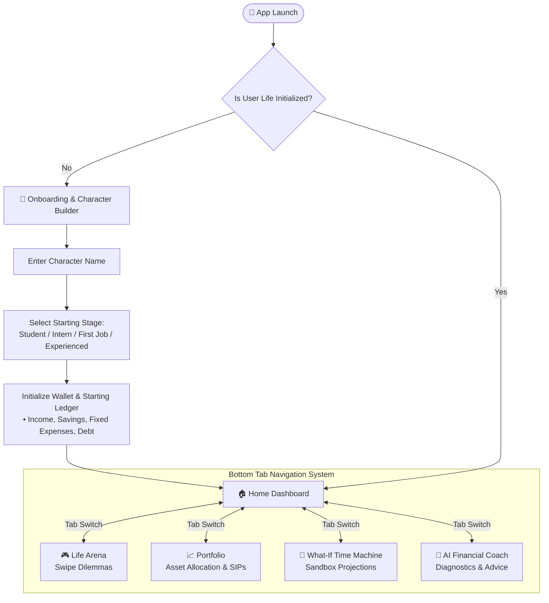
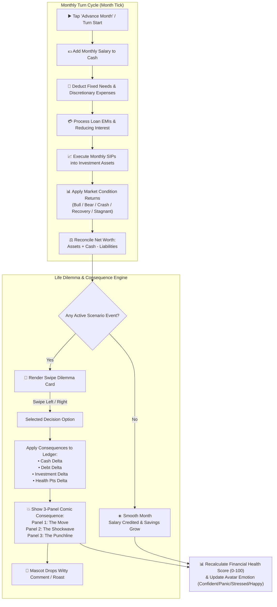

# Finance Life Simulator — Application Workflow & Architecture

This document contains the complete flowchart, user journey, turn-based calculation engine loop, and data flow architecture for **Finance Life Simulator**.

---

## 1. High-Level App User Flowchart

---

## 2. Core Turn-Based Gameplay & Math Engine Loop

This is the central turn loop that executes every time a player advances a month or makes a decision:

---

## 3. Screen Breakdown & State Coordination Architecture

```mermaid
flowchart LR
    subgraph DashboardScreen ["1. Home Dashboard"]
        NW["Net Worth Hero Card"]
        HG["Radial Health Gauge (0-100)"]
        AV["60fps Reactive Avatar"]
        CB["Coin Burst Particles"]
    end

    subgraph LifeScreen ["2. Life Arena"]
        SDC["Swipe Dilemma Cards"]
        CCM["Comic Storyboard Modal"]
        MC["Mascot Companion"]
        LOG["Decision History Log"]
    end

    subgraph PortfolioScreen ["3. Portfolio Engine"]
        HHI["HHI Diversification Scorer (0-15 Pts)"]
        MCY["Market Environment Cycles"]
        SIP["Active Monthly SIP Controls"]
    end

    subgraph WhatIfScreen ["4. What-If Sandbox"]
        TMD["Time Machine Age Scrubber (Age 21-35)"]
        SPLIT["Split-Screen Reality Mirror A vs B"]
        JCURVE["Dual Compounding J-Curve Graph"]
    end

    subgraph CoachScreen ["5. AI Coach & Diagnostics"]
        ARCH["Behavioral Bias Archetype Engine"]
        QA["Offline Pedagogical QA"]
    end

    DashboardScreen <-->|Shared Zustand Store| LifeScreen
    LifeScreen <-->|Shared Zustand Store| PortfolioScreen
    PortfolioScreen <-->|Shared Zustand Store| WhatIfScreen
    WhatIfScreen <-->|Shared Zustand Store| CoachScreen
```

---

## 4. Detailed Component & Step-by-Step Flow Explanation

### 1. Character Creation (Onboarding)
- Player sets character name and selects starting stage (*Student, Intern, First Job, Experienced*).
- Initializes starting balances, income, fixed expenses, savings, and debt liabilities.

### 2. Home Dashboard (Command Center)
- Displays **Net Worth**, **Monthly Cash Flow**, **Reactive Avatar Mood**, and **Health Score (0-100)**.
- **Advance Month Button**: Executes one simulation turn, credits income, pays fixed expenses, processes loan EMIs, and triggers the Reanimated 60fps coin explosion.

### 3. Life Arena (Swipe Dilemma Engine)
- Renders **Swipe Dilemma Cards** (*Reigns style*) for decision making.
- Swiping Left/Right applies instant ledger changes (Cash, Debt, Investment, Health Pts).
- Renders **3-Panel Comic Consequence Storyboard** (*The Move → The Shockwave → The Punchline*) to explain the financial trade-off.

### 4. Portfolio Management
- Allocates funds across 5 asset classes (Index Funds, FDs, Bonds, Gold, Stocks).
- Evaluates portfolio risk concentration via the **Herfindahl-Hirschman Index (HHI)**.

### 5. "What-If?" Time Machine Sandbox
- Fast-forwards simulation ages 21 to 35 via an interactive analog scrubber dial.
- Displays **Split-Screen Reality Mirror** (Baseline vs What-If) and a dual compounding J-curve graph.

### 6. AI Financial Coach
- Analyzes past player choices to detect behavioral archetypes (*Panic Seller, Debt Spender, Illiquid Chaser, Wealth Architect*).
- Provides instant offline pedagogical answers to user questions.
